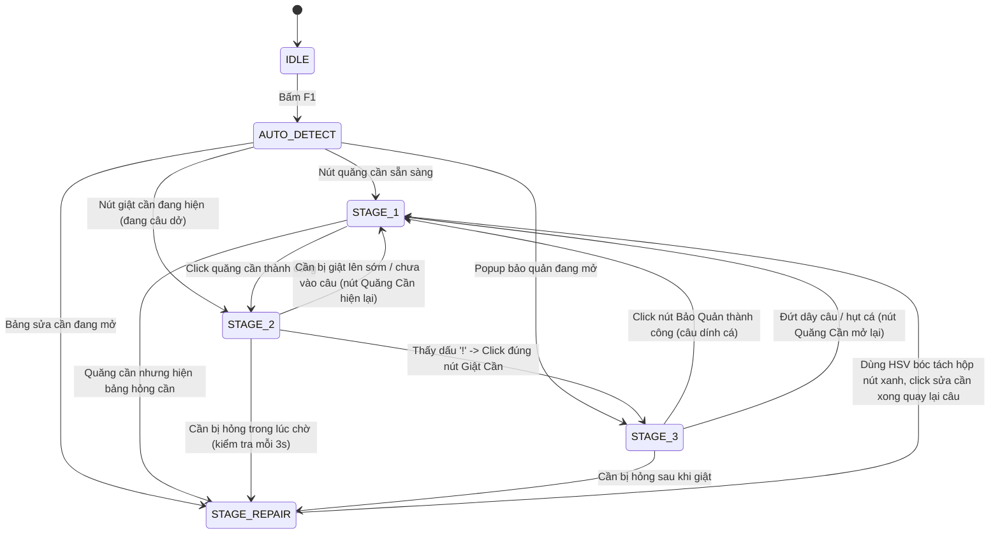

# 📋 TÀI LIỆU BÀN GIAO TOÀN DIỆN & HƯỚNG DẪN FIX LỖI DỰ ÁN AUTO FISHING BOT
> **Dành cho Claude (Phiên làm việc mới)**: Bạn đang đóng vai trò **Senior Software Engineer & Tech Lead**, hỗ trợ một sinh viên năm 3 Back-End (.NET). Hãy giữ phong cách làm việc nghiêm khắc, giải thích sâu vào bản chất kiến trúc, chỉ rõ nguyên nhân gốc rễ (Root Cause), tuân thủ Clean Code & SOLID và giải quyết triệt để vấn đề mà không đoán mò.

---

## 1. TỔNG QUAN HỆ THỐNG & CÔNG NGHỆ (SYSTEM OVERVIEW)
* **Tên dự án**: Auto Fishing Bot (*Play Together*)
* **Môi trường**: Windows 10/11 (Độ phân giải hiển thị chuẩn 1920x1080), Python 3.13, OpenCV, MSS, Win32 API (`SendInput`), Tkinter GUI.
* **Nguyên tắc vận hành**:
  - Chạy **Offline 100%**, xử lý hình ảnh thời gian thực hoàn toàn trên RAM (`np.ndarray`), **Zero Disk Pollution** (không ghi file ảnh rác xuống ổ cứng khi đang trong vòng lặp câu).
  - Điều khiển bằng **Global Keyboard Hook**: `F1` = Bắt đầu / Tiếp tục, `F2` = Dừng khẩn cấp.
  - Hỗ trợ **thu nhỏ bot xuống Taskbar (`-`)** mà bot vẫn tự câu ngầm bình thường vì MSS chụp trực tiếp Desktop Framebuffer và Win32 `SendInput` gửi sự kiện chuột theo tọa độ tuyệt đối vào Windows Input Queue.

---

## 2. KIẾN TRÚC MÃ NGUỒN (SOURCE CODE MAP)
```text
D:\ToolPT\
├── app_gui.py              # Tkinter Modern GUI, Thread-safe Log Queue, nút "Soi Mắt Bot", Tự xóa log 60s
├── bot_engine.py           # Finite State Machine (FSM) 4 trạng thái, Self-Healing, NameLocator
├── config.json             # Ngưỡng tin cậy (thresholds), đường dẫn templates, delays, hotkeys
├── CaiDat.bat / ChayTool.bat # Script tự động cài đặt dependency và chạy ngầm bằng pythonw.exe
├── core/
│   ├── detector.py         # TemplateMatcher (OpenCV), Anti-Clustering Rejection Sampling (Ring Buffer 24 clicks)
│   ├── head_locator.py     # NameLocator: Nhận diện chữ xanh dạ quang đa nhân vật & đa tỉ lệ (0.75x - 1.25x)
│   ├── input_sim.py        # InputSimulator: Win32 SendInput, micro-jitter, giữ chuột ngẫu nhiên (40-90ms)
│   ├── screen_capture.py   # ScreenCapturer: MSS Desktop Framebuffer grabber (10-15ms/frame)
│   ├── hotkey_manager.py   # Global Keyboard Hook (F1, F2)
│   └── diagnostics.py      # Module chẩn đoán khung hình
└── assets/
    ├── B1_QuangCan/        # inner_phao_cau.png (Template phao câu chuẩn 1080p)
    ├── B2_DangCau/
    │   ├── nut_giat_can.png    # Template nút giật cần (180x181 tại góc dưới bên phải)
    │   ├── vat_neo_ten/        # Thư mục chứa bảng tên nhân vật (columbinaa.png, mumyua.png)
    │   └── dau_cham_than/      # Các template dấu chấm than đa sắc
    ├── B3_BaoQuan/         # nut_bao_quan.png, baoquan_1080p.jpg
    └── B4_SuaCan/          # title/ (tiêu đề 'Thông tin sửa chữa'), button/ (btn_cash_icon)
```

---

## 3. LOGIC HOẠT ĐỘNG CỦA FINITE STATE MACHINE (FSM)



### Chi tiết 4 State nghiệp vụ:
1. **STAGE_1 (Quăng cần)**:
   - Quét tìm `inner_phao_cau.png` trong **Action ROI** (góc dưới bên phải: $X \ge 65\%, Y \ge 55\%$).
   - Click ngẫu nhiên phân tán bên trong nút ([`get_random_click_point`](file:///D:/ToolPT/core/detector.py)), đợi 0.7s kiểm tra có bị bật bảng sửa cần không. Nếu bình thường -> chuyển sang `STAGE_2`.
2. **STAGE_2 (Chờ dấu '!' -> Giật cần)**:
   - **Định vị nhân vật (`NameLocator`)**: Quét mặt nạ màu xanh dạ quang (Neon Green Mask `G > 170, R < 120, B < 120`) mỗi 0.5s để tính ROI đầu: `head_roi = (plate.x - 50, plate.y - 180, plate.w + 100, 190)`. Hỗ trợ đa tỉ lệ (`0.75x` đến `1.25x`) để kháng lệch zoom camera.
   - **Định vị trước nút Giật Cần**: Dò vị trí nút Giật Cần trong Action ROI ở tỷ lệ gốc (`multi_scale=False`). Lưu sẵn tọa độ để khi cá cắn là bấm ngay, không tốn độ trễ dò tìm.
   - **Kiểm tra bảng sửa cần (Chống Stall)**: Quét tiêu đề sửa cần mỗi 3.0s/lần bằng đơn tỉ lệ (`multi_scale=False`), đảm bảo nhịp canh dấu `!` duy trì ở tần số tối đa (~33 FPS).
   - **Quét dấu '!'**: Chụp riêng `effective_region` (vùng đầu nhân vật) và so khớp với thư mục `assets/B2_DangCau/dau_cham_than`.
   - **Hành động khi thấy '!'**: Click trực tiếp vào tọa độ nút Giật Cần đã định vị sẵn (`(1654, 817) 180x181` kèm jitter chống macro), chuyển sang `STAGE_3`.
3. **STAGE_3 (Lưu cá vào Balo hoặc tự phục hồi)**:
   - Chờ delay 2.0s. Quét tìm nút `Bảo Quản`. Nếu thấy -> click lưu cá, tăng biến đếm `caught`, quay về `STAGE_1`.
   - **Cơ chế tự phục hồi đứt dây**: Nếu cá chạy mất hoặc đứt dây câu, popup Bảo Quản không hiện mà nút Quăng Cần xuất hiện lại -> bot lập tức phát hiện trong vòng ~100ms, tăng biến đếm `missed_after_click` và quay lại `STAGE_1` để quăng cần mới.
4. **STAGE_REPAIR (Tự động sửa cần bất kể mệnh giá tiền)**:
   - Hàm [`_find_repair_button`](file:///D:/ToolPT/bot_engine.py#L104): Dùng phân đoạn màu HSV Sky-Blue (`H [90..108], S [110..255], V [170..255]`) bóc tách **toàn bộ hộp nút bấm màu xanh** ($260 \times 90$ px).
   - Click ngẫu nhiên phân tán khắp bề mặt nút xanh, chờ 1.5s hiệu ứng sửa cần rồi quay lại `STAGE_1`.

---

## 4. LỊCH SỬ HAI BẢN VÁ (`fix_roi_v2` vs `fix_scan_stall`)
1. **Bản `fix_roi_v2` (Bản chạy câu cá rất tốt)**:
   - Định vị nhân vật theo tên chữ xanh và định vị nút Giật Cần trước.
   - Khi có dấu `!`, click chuẩn xác vào **nút Giật Cần**. Cơ chế này giật cá rất dính, không bao giờ trượt.
2. **Bản `fix_scan_stall` (Bản tối ưu hiệu năng & thêm tính năng)**:
   - Phát hiện nguyên nhân vòng lặp bị đứng 1 giây: hàm kiểm tra sửa cần cũ chạy đa tỉ lệ trên toàn màn hình 1080p tốn 990ms -> đã chuyển sang đơn tỉ lệ và giãn chu kỳ 3.0s/lần.
   - Thêm `STAGE_REPAIR` sửa cần tự động, bộ đếm thống kê `self.stats`, bộ lọc click chống chụm (`avoid` keepout).
   - **Nhược điểm Claude bản trước mắc phải**: Tự ý đổi điểm click giật cần từ nút Giật Cần sang "click ngẫu nhiên nửa phải màn hình". Trên bản PC client, click vào sàn gỗ/mặt đất không kích hoạt giật cần -> dẫn đến hụt cá 1/3 số lần.
3. **Trạng thái hiện tại trong code `D:\ToolPT\`**:
   - Đã gộp thành công: Giữ nguyên cơ chế click đúng nút Giật Cần của `fix_roi_v2`, tích hợp các tính năng sửa cần, chống nghẽn và tự phục hồi của `fix_scan_stall`.

---

## 5. BẰNG CHỨNG CHẨN ĐOÁN & NGUYÊN NHÂN GỐC RỄ LỖI VÒNG LẶP HIỆN TẠI

### ⚠️ Hiện tượng người dùng báo cáo:
> *"nó cứ bị vòng lặp khi thả cần câu xuống, mặc dù chưa có cá hay gì cả nó cứ báo là hiện dấu chấm than"*
> Log thực tế ghi nhận:
> `[20:44:14] -> PHÁT HIỆN DẤU CHẤM THAN TRÊN ĐẦU! (Độ khớp: 0.75 [mauhonghoidam.png] tại 1186, 328)`
> `[20:44:22] -> PHÁT HIỆN DẤU CHẤM THAN TRÊN ĐẦU! (Độ khớp: 0.75 [mauhonghoidam.png] tại 1186, 328)`
> `[20:44:31] -> PHÁT HIỆN DẤU CHẤM THAN TRÊN ĐẦU! (Độ khớp: 0.74 [mauhonghoidam.png] tại 1186, 328)`

### 🔬 KẾT QUẢ ĐIỀU TRA KỸ THUẬT CHÍNH XÁC 100%:
1. **Tọa độ cố định tuyệt đối `(1186, 328)`**:
   - Dấu "!" do cá cắn thật sẽ xuất hiện ngẫu nhiên theo thời gian (sau 4–15 giây) và dao động pixel nhẹ theo hiệu ứng gợn sóng/phao.
   - Ở đây, **cứ đúng ~2.5s sau khi quăng cần**, bot lập tức báo thấy `!` tại **đúng pixel `(1186, 328)`**, lặp lại liên tục với template **`mauhonghoidam.png`** (độ khớp 0.74 – 0.75).
2. **Nguồn gốc template `mauhonghoidam.png`**:
   - Trong code có hàm `_sync_downloads_templates` tự động cắt ảnh từ Downloads bằng tỉ lệ mù: `img[int(h * 0.05):int(h * 0.55), int(w * 0.35):int(w * 0.65)]`.
   - File `assets/B2_DangCau/dau_cham_than/mauhonghoidam.png` có kích thước $46 \times 51$ px (rộng hơn dài, trong khi dấu `!` thật luôn cao và hẹp).
   - Phân tích màu sắc thực tế: 10 hàng pixel phía dưới của `mauhonghoidam.png` có giá trị BGR `[156, 112, 168]` — **chính là màu tím hồng của huy hiệu danh hiệu "Ngồi không ăn lương" trên đầu nhân vật!**
   - Phần trên của ảnh là màu tóc/nền.
3. **Kết luận**:
   - `mauhonghoidam.png` **KHÔNG PHẢI LÀ DẤU CHẤM THAN**, mà là một mảnh cắt chứa một phần huy hiệu danh hiệu "Ngồi không ăn lương" của nhân vật!
   - Vì nhân vật lúc nào cũng đội chiếc huy hiệu màu hồng này trên đầu, nên mỗi khi quăng cần xong và vào `STAGE_2`, bot quét vùng đầu nhân vật lập tức thấy `mauhonghoidam.png` khớp **0.75** (ngưỡng đang là 0.68).
   - Bot lập tức tưởng cá cắn -> giật cần -> không có cá -> nút quăng cần hiện lại -> bot tưởng đứt dây -> quăng cần lại -> lặp vô tận!
   - Ngoài ra, template `maucamnhat.png` cũng cho điểm khớp tĩnh lên tới **0.66** trên đầu nhân vật khi không có cá.

---

## 6. CHECKLIST NHIỆM VỤ DÀNH CHO CLAUDE MỚI

### Nhiệm vụ 1: Dọn dẹp thư mục `assets/B2_DangCau/dau_cham_than/`
- Thư mục này đang chứa 18 template, trong đó một số file bị cắt lỗi chứa tóc/huy hiệu nhân vật (`mauhonghoidam.png`, `maucamnhat.png`).
- Cần loại bỏ các template rác này ra khỏi thư mục quét `dau_cham_than/` (chuyển vào thư mục backup `assets/_backup_old/bad_templates/`).
- Các template chuẩn của dấu `!` là các ảnh có hình dáng dấu chấm than rõ rệt (dài và hẹp, ví dụ `chamthan_hong.png` $55\times35$, `chamthan_vang.png` $50\times35$, `mautrang.png`, `xanhla.png`...).

### Nhiệm vụ 2: Vô hiệu hóa hàm `_sync_downloads_templates` trong `bot_engine.py`
- Tắt hoặc xóa lệnh gọi `self._sync_downloads_templates()` trong `BotEngine.__init__`.
- Lý do: Hàm này tự động quét thư mục Downloads của người dùng và crop mù rồi ghi đè vào `assets`, gây ô nhiễm template và tạo ra các file rác như `mauhonghoidam.png`.

### Nhiệm vụ 3: Cân chỉnh ngưỡng phát hiện dấu `!` (`b2_cham_than`)
- Trong `config.json`, đặt ngưỡng `"b2_cham_than": 0.72` (hoặc `0.70`).
- Thực nghiệm trên các frame cá cắn thật cho thấy dấu `!` thật luôn đạt điểm khớp từ `0.75` đến `0.97`. Đặt ngưỡng `0.72` sẽ loại trừ hoàn toàn các nhiễu nền ($\le 0.62$).

### Nhiệm vụ 4: Kiểm tra tính toàn vẹn của State Machine
- Giữ nguyên cơ chế **Multi-Scale NameLocator** trong [`core/head_locator.py`](file:///D:/ToolPT/core/head_locator.py) (đã test thành công 100% khớp `columbinaa.png` ở 0.71 và `mumyua.png` ở 0.79).
- Giữ nguyên cơ chế click đúng **nút Giật Cần** khi cá cắn.
- Giữ nguyên cơ chế tự sửa cần (`STAGE_REPAIR`) và phục hồi đứt dây trong `STAGE_3`.

---
*Tài liệu này phản ánh toàn bộ mã nguồn thực tế tại `D:\ToolPT\` tính đến 20:52 ngày 23/10/2026.*
