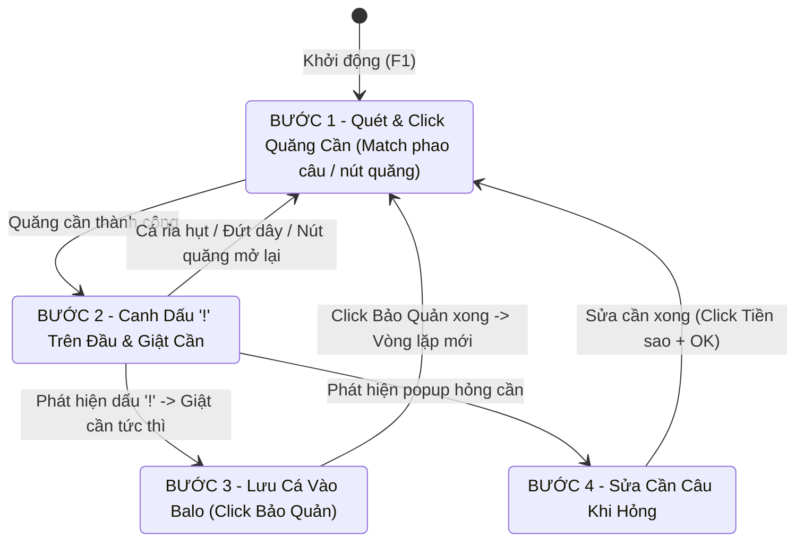

# BÁO CÁO KỸ THUẬT & HỒ SƠ DỰ ÁN: AUTO FISHING BOT (PLAY TOGETHER)
> **Tài liệu bàn giao kỹ thuật & Chẩn đoán lỗi toàn diện dành cho Senior AI/Developer tiếp nhận codebase.**  
> Repository GitHub: `trangiabao-dev/Auto-Fishing-Bot` | Ngôn ngữ: `Python 3.10+ / OpenCV`

---

## 1. TỔNG QUAN KIẾN TRÚC DỰ ÁN (PROJECT OVERVIEW)

### 1.1. Mục tiêu & Nguyên lý hoạt động
Tool tự động câu cá hoàn toàn bằng **Thị giác máy tính (Computer Vision - OpenCV)**, hoạt động độc lập ở tầng User Mode bên ngoài game, không can thiệp bộ nhớ (Zero Memory Injection), không đọc/ghi RAM nhằm đảm bảo an toàn tài khoản tối đa.

Mã nguồn được cấu trúc theo mô hình **Finite State Machine (FSM)** trong file [`bot_engine.py`](file:///D:/GitHub%20Desktop/GitHub/Auto-Fishing-Bot/bot_engine.py):



### 1.2. Các thành phần lõi (Core Modules)
1. **[`core/detector.py`](file:///D:/GitHub%20Desktop/GitHub/Auto-Fishing-Bot/core/detector.py) (`TemplateMatcher`)**:
   * Thực hiện so khớp ảnh mẫu (`cv2.matchTemplate` với `cv2.TM_CCOEFF_NORMED`) ở thang xám (Grayscale).
   * Hỗ trợ tìm kiếm đơn tỷ lệ (1.0x native) và đa tỷ lệ (Multi-scale), cache ảnh mẫu trong RAM.
2. **[`core/head_locator.py`](file:///D:/GitHub%20Desktop/GitHub/Auto-Fishing-Bot/core/head_locator.py) (`NameLocator`)**:
   * Định vị bảng tên nhân vật qua mặt nạ màu xanh neon (`_green_mask`), bóc tách riêng hình dáng chữ cái để không phụ thuộc vào nền đen bán trong suốt.
   * Tính toán vùng đầu (`head_roi`) nằm ngay trên đỉnh bảng tên nhân vật để giới hạn phạm vi quét dấu `!`.
3. **[`core/screen_capture.py`](file:///D:/GitHub%20Desktop/GitHub/Auto-Fishing-Bot/core/screen_capture.py) (`ScreenCapturer`)**:
   * Chụp màn hình bằng thư viện `mss` đạt tốc độ cao (~15-30ms/frame).
4. **[`core/input_sim.py`](file:///D:/GitHub%20Desktop/GitHub/Auto-Fishing-Bot/core/input_sim.py)**:
   * Giả lập click chuột ngẫu nhiên (Human-like Randomization) trong bán kính nút bấm và thời gian giữ chuột ngẫu nhiên (40-90ms) chống anti-cheat.

---

## 2. BẰNG CHỨNG THỰC NGHIỆM QUA 3 GIAI ĐOẠN

Dưới đây là đối chiếu chi tiết bằng chứng thực tế từ 3 ảnh chụp màn hình và log bot:

### Giai đoạn 1: Hồ bí ngô Halloween (Trước khi sửa Thác Nước) — HOẠT ĐỘNG HOÀN HẢO


* **Log thực tế lúc 13:37:**
  ```text
  [13:37:00] [BƯỚC 1: Quét & Click Nút Quăng Cần] -> Đã thấy nút Quăng Cần (0.78). Click tại (1599, 761)
  [13:37:01] [BƯỚC 2: Chờ Dấu Chấm Than -> Giật Cần] Đang canh chừng Dấu Chấm Than...
  [13:37:02]  -> Định vị nhân vật 'columbinaa.png' (độ khớp 0.73): vùng đầu = (613, 269, 230, 190)
  [13:37:02]  -> Đã định vị nút Giật Cần tại (1654, 817) 180x181 (độ khớp 0.76)
  [13:37:28]  -> PHÁT HIỆN DẤU CHẤM THAN TRÊN ĐẦU! (Độ khớp: 0.92 [chamthan_hong.png] tại 700, 370)
  [13:37:28]  -> KÍCH HOẠT: Giật cần câu tại nút bấm (1776, 867)
  [13:37:30]  -> Đã thấy nút Bảo Quản (baoquan_1080p.jpg, độ khớp 0.99). Click tại (1419, 852)
  [13:37:30] 📊 [THỐNG KÊ] Thấy '!': 1 | Dính cá: 1 | Giật nhưng hụt: 0 => tỉ lệ dính 100% (1/1)
  ```
* **Đánh giá:**
  * Ngưỡng `b2_cham_than` lúc này là `0.72`.
  * Dấu `!` xuất hiện đạt độ khớp **0.92** (với template `chamthan_hong.png`).
  * Bot phát hiện ngay tức thì và giật dính cá 100%.

---

### Giai đoạn 2: Biển Sâu trên thuyền (Trước khi sửa Thác Nước) — HOẠT ĐỘNG TỐT


* **Log thực tế lúc 13:38:**
  ```text
  [13:38:15]  -> Định vị nhân vật 'columbinaa.png' (độ khớp 0.72): vùng đầu = (609, 217, 230, 190)
  [13:38:19]  -> PHÁT HIỆN DẤU CHẤM THAN TRÊN ĐẦU! (Độ khớp: 0.72 [khongbietmau2.png] tại 622, 304)
  [13:38:19]  -> KÍCH HOẠT: Giật cần câu tại nút bấm (1717, 935)
  ...
  [13:38:38]  -> PHÁT HIỆN DẤU CHẤM THAN TRÊN ĐẦU! (Độ khớp: 0.95 [chamthan_hong.png] tại 695, 326)
  [13:38:41]  -> Đã thấy nút Bảo Quản (độ khớp 0.99). Click tại (1551, 794)
  [13:38:41] 📊 [THỐNG KÊ] Thấy '!': 3 | Dính cá: 2 | Giật nhưng hụt: 1 => tỉ lệ dính 67% (2/3)
  ```
* **Điểm cốt lõi cần lưu ý:**
  * Lúc 13:38:19, cá cắn đạt độ khớp **0.72** (khớp với `khongbietmau2.png`).
  * Vì ngưỡng đang là `0.72`, bot đã bắt kịp tín hiệu này! Nếu ngưỡng bị ép lên `0.85`, cú cắn này chắc chắn sẽ bị bỏ lọt.

---

### Giai đoạn Sự cố: Đi ra bãi "Thác Nước" bị lỗi giật cần liên tục
* **Hiện tượng tại Thác Nước (lúc ~13:16):**
  * Tại Thác Nước, bọt nước trắng bắn tung tóe kết hợp với cần câu màu vàng phản chiếu ánh nắng.
  * Template `mauvangdam.png` (dấu chấm than màu vàng) bị khớp nhầm vào bọt nước/cần câu với điểm số $0.78 - 0.80$.
  * Với ngưỡng cấu hình `0.72`, bot vừa quăng cần xong là tưởng cá cắn $\rightarrow$ Giật cần ngay lập tức $\rightarrow$ Đứt dây / hụt cá $\rightarrow$ Lặp vô tận.

---

### Giai đoạn 3: Hồ bí ngô Halloween (SAU KHI SỬA THÁC NƯỚC) — BOT HỎNG HOÀN TOÀN


* **Log thực tế lúc 13:58 - 14:00:**
  ```text
  [13:58:06]  -> Định vị nhân vật 'columbinaa.png' (độ khớp 0.68): vùng đầu = (841, 313, 237, 190)
  [13:58:08]  -> Định vị nhân vật 'columbinaa.png' (độ khớp 0.79): vùng đầu = (609, 221, 230, 190)
  [13:58:39]  -> Định vị nhân vật 'columbinaa.png' (độ khớp 0.68): vùng đầu = (841, 313, 237, 190)
  [13:58:39] ⚠️ Cần câu bị giật lên lại / chưa vào câu (Nút Quăng Cần hiện lại, khớp 0.82)! Quay về BƯỚC 1 quăng lại...
  [13:58:39] 📊 [THỐNG KÊ] Thấy '!': 1 | Dính cá: 1 | Giật nhưng hụt: 0 | Mất cá khi chưa thấy '!': 1 => tỉ lệ dính 50% (1/2)
  [13:58:39]  -> [HIỆU NĂNG] Vòng quét '!' từng đứng 892ms (phải < 250ms, dấu '!' chỉ hiện 400-600ms)
  ...
  [13:59:09]  -> Định vị nhân vật 'columbinaa.png' (độ khớp 0.68): vùng đầu = (841, 313, 237, 190)
  [13:59:10] ⚠️ Cần câu bị giật lên lại / chưa vào câu (Nút Quăng Cần hiện lại, khớp 0.80)!
  [13:59:10] 📊 [THỐNG KÊ] Thấy '!': 1 | Dính cá: 1 | Giật nhưng hụt: 0 | Mất cá khi chưa thấy '!': 2 => tỉ lệ dính 33% (1/3)
  [13:59:10]  -> [HIỆU NĂNG] Vòng quét '!' từng đứng 829ms (phải < 250ms, dấu '!' chỉ hiện 400-600ms)
  ```
* **Hậu quả:**
  * Cá cắn, cần câu bị rút lên, nhưng bot **hoàn toàn không phát hiện thấy dấu `!` nào** ("Mất cá khi chưa thấy '!': 2").

---

## 3. MỔ XẺ NGUYÊN NHÂN GỐC RỄ (DEEP ROOT-CAUSE ANALYSIS)

Việc sửa lỗi ở Thác Nước đã phạm phải 3 sai lầm kỹ thuật nghiêm trọng dẫn đến việc hỏng dây chuyền:

### Lỗ hổng 1: Xóa nhầm template cốt lõi & Ép ngưỡng quá cao (Overfitting)
* **Sai lầm:** Khi thấy `mauvangdam.png` và `chamthan_vang.png` bị nhận nhầm ở thác nước, lập trình viên đã di chuyển **toàn bộ các template màu vàng** vào thư mục `_backup_old/bad_templates/`, đồng thời tăng cứng `"b2_cham_than"` trong `config.json` lên **0.85**.
* **Hệ quả:** Dấu `!` cơ bản trong Play Together **chính là màu vàng**. Sau khi bị tước mất template màu vàng, bot chỉ còn lại các file màu hồng, tím, trắng. Khi dấu `!` màu vàng xuất hiện trên đầu nhân vật, việc đối chiếu qua ảnh xám với template màu khác và đòi hỏi điểm tương đồng $\ge 0.85$ là bất khả thi $\rightarrow$ **Bot bị mù hoàn toàn trước dấu `!` thật**.

### Lỗ hổng 2: Lag "chết đứng" 892ms (Blocking the Fast Reaction Path)
* **Đặc tính vật lý:** Dấu `!` chỉ tồn tại trên màn hình từ **400ms đến 600ms**.
* **Thực trạng trong code:** Tại [`bot_engine.py` (L480-L530)](file:///D:/GitHub%20Desktop/GitHub/Auto-Fishing-Bot/bot_engine.py#L480-L530), cứ mỗi 0.5s bot lại gọi đồng bộ:
  1. Chụp toàn màn hình Full HD (`capturer.capture(None)`).
  2. Quét qua 16 mức scale trong `NameLocator.locate()`.
  3. Quét kiểm tra nút Quăng cần, popup sửa cần.
* Toàn bộ các thao tác I/O và CPU-heavy này chặn đứng vòng lặp `while` trong suốt **829ms - 892ms**. Khi cá cắn đúng vào khoảng nghỉ 892ms này, dấu `!` xuất hiện và biến mất trước khi frame tiếp theo được chụp.

### Lỗ hổng 3: "Loạn thị" — Vùng đầu nhảy sang người chơi khác (Target Hijacking)
* Nhìn lại log:
  * `[13:58:08] -> vùng đầu = (609, 221)` (Vị trí nhân vật của bạn).
  * `[13:58:39] -> vùng đầu = (841, 313)` (Bị nhảy sang nhân vật `BéTrăng` đứng bên cạnh).
* Khi camera zoom xa hoặc nhân vật cử động nhẹ, điểm số của `columbinaa.png` dao động. Thuật toán quét toàn màn hình thấy tên người bên cạnh cũng có các pixel xanh neon đạt 0.68 $\rightarrow$ bot tự động dời `ROI` sang đầu người lạ.
* Cá cắn trên đầu bạn, nhưng bot lại đang mải mê soi đầu người khác.

---

## 4. TƯ DUY JUNIOR VS SENIOR DEVELOPER

> [!IMPORTANT]
> Đây là bài học kinh nghiệm cốt lõi để nâng cấp tư duy thiết kế phần mềm:

| Đặc điểm | Cách tiếp cận kiểu Junior | Cách tiếp cận chuẩn Senior Developer |
| :--- | :--- | :--- |
| **Khi gặp False Positive (ở Thác Nước)** | Thấy template màu vàng bị dính bọt nước $\rightarrow$ Xóa file vàng, tăng ngưỡng lên 0.85. *(Sửa triệu chứng bề nổi, phá hỏng toàn bộ các bối cảnh khác)*. | **Phân tích đặc trưng bất biến (Invariance Analysis)**: Bọt nước hay cần câu là vật thể tĩnh hoặc dao động liên tục. Dấu `!` có đặc tính bất biến là **đột ngột xuất hiện (Temporal Novelty)** và **nằm ngay chính giữa trục đầu**. Phải dùng thuật toán trừ khung hình (Frame Differencing) thay vì dựa vào màu sắc tĩnh. |
| **Vòng lặp thời gian thực (<50ms)** | Nhồi nhét việc định vị lại nhân vật, chụp Full HD, tìm popup sửa cần vào chung luồng với vòng lặp bắt cá. | **Bảo vệ luồng tới hạn (Critical Path Isolation)**: Vòng lặp STAGE 2 chỉ crop vùng nhỏ 150x150px, chạy $<25\text{ms}$. Tác vụ định vị toàn màn hình chỉ chạy khi cần thiết hoặc chạy ở background thread. |
| **Theo dõi mục tiêu (Tracking)** | Cứ có vị trí nào điểm $> 0.55$ là lập tức gán mục tiêu mới. | **Khóa mục tiêu (Spatial Hysteresis & Anchor Lock)**: Nhân vật đứng câu không thể dịch chuyển $200\text{px}$ sau $0.5\text{s}$. Nếu phát hiện vị trí mới nhảy vọt đột ngột ra xa, phải từ chối và bám chặt mục tiêu cũ. |

---

## 5. ĐỀ XUẤT GIẢI PHÁP CHO CLAUDE MỚI TIẾP NHẬN

Dự án hiện đã có sẵn module [`core/bite_detector.py`](file:///D:/GitHub%20Desktop/GitHub/Auto-Fishing-Bot/core/bite_detector.py) được xây dựng theo chuẩn Senior nhưng chưa được tích hợp vào `bot_engine.py`.

Claude mới tiếp nhận codebase nên triển khai theo 3 bước sau:

1. **Khôi phục tài nguyên mẫu (Restore Baseline):**
   * Di chuyển các template màu vàng trong `assets/_backup_old/bad_templates/` (`chamthan_vang.png`, `mauvangdam.png`) trở lại thư mục `assets/B2_DangCau/dau_cham_than/`.
   * Trả ngưỡng `"b2_cham_than"` trong `config.json` về mức cân bằng `0.76 - 0.78` (thay vì 0.85).
2. **Khóa mục tiêu chống nhảy sang người khác (`head_locator.py` / `bot_engine.py`):**
   * Áp dụng luật Anchor Lock: Chỉ cập nhật vị trí mới nếu khoảng cách tới vị trí cũ $< 40\text{px}$. Nếu phát hiện khoảng cách $> 40\text{px}$, giữ nguyên vị trí cũ.
3. **Triệt tiêu độ trễ 892ms trong STAGE 2:**
   * Tăng `relocate_interval` lên $2.5\text{s}$ hoặc chỉ định vị 1 lần duy nhất ngay sau khi quăng cần.
   * Tuyệt đối không chụp Full HD mỗi 0.5s trong lúc đang chờ cá cắn.
4. **Tích hợp [`BiteDetector`](file:///D:/GitHub%20Desktop/GitHub/Auto-Fishing-Bot/core/bite_detector.py) (Giải pháp triệt để dài hạn):**
   * Sử dụng thuật toán so lệch khung hình theo thời gian (Temporal Differencing) để phát hiện sự xuất hiện đột ngột của hình dáng viên thuốc `!`. Thuật toán này miễn nhiễm hoàn toàn với bọt nước thác nước, màu tóc, màu nón và mọi thời tiết ngày/đêm.

---

## 6. DỮ LIỆU THỰC NGHIỆM MỚI NHẤT (TEST 5 BỐI CẢNH & GÓC NHÌN CAMERA)

Dưới đây là kết quả kiểm thử thực tế trên bản gốc hôm qua (threshold 0.72) ở 3 góc nhìn camera khác nhau:

### 6.1. Bối cảnh Thác Nước (Bọt nước trắng + Cần câu vàng phản chiếu)
* **Hiện tượng:** Bot bị giật non / hụt cá liên tục. Tỉ lệ dính chỉ đạt **25% - 30%** (Thấy 28 lần nhưng giật hụt 17 lần!).
* **Bằng chứng Log:**
  - Vừa quăng cần 1s - 2s: PHÁT HIỆN DẤU CHẤM THAN TRÊN ĐẦU! (Độ khớp: 0.74 - 0.76 [chamthan_vang.png]).
  - Giật cần ngay lập tức: ⚠️ [ĐỨT DÂY / HỤT CÁ] Phát hiện nút Quăng Cần (0.80) đã mở lại!.
  - **Nguyên nhân:** False Positive từ bọt nước trắng và ánh vàng của cần câu đè lên vùng tìm kiếm dấu '!'.

### 6.2. Góc nhìn ngang bên trái/phải (Side View)
* **Hiện tượng:** Tỉ lệ câu thành công khá tốt (ví dụ khớp cothelamauxanhla.png 0.98 ở Hình 3 và bắt được cá).
* **Vấn đề tồn đọng:** Thỉnh thoảng vẫn trễ nhịp hoặc không giật cần do vòng quét bị đóng băng (stutter 585ms - 751ms), vượt quá thời gian tồn tại 400ms của dấu '!'.

### 6.3. Góc nhìn từ trên cao nhìn xuống (Top-down View)
* **Hiện tượng:** Tỉ lệ hụt cực cao, nhiều lần cá cắn nhưng bot hoàn toàn không giật cần.
* **Bằng chứng Log:**
  - Vòng quét bị đứng nghiêm trọng: 1259ms - 1406ms!
  - Mất dấu nút giật cần: [CẢNH BÁO] Không tìm thấy nút giật cần!.
  - Tỉ lệ dính cá tụt dốc xuống **30% - 33%**.
* **Nguyên nhân hình học:** Khi nhìn từ trên cao chúc xuống:
  1. Phối cảnh làm bảng tên và đỉnh đầu co ngắn lại (perspective foreshortening), công thức cứng y - 180 bị lệch khỏi đỉnh đầu thật.
  2. Dấu '!' bị biến dạng góc nhìn 3D khiến template phẳng không đạt ngưỡng.
